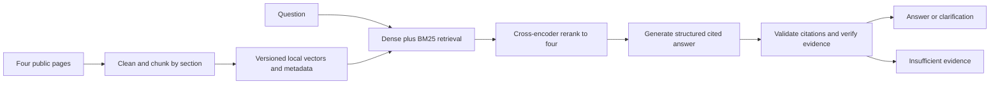

# Remote Work Policy Assistant

A Project 1 RAG assistant for new remote employees, grounded in four public GitLab handbook pages. It searches with local embeddings and BM25, reranks evidence, and produces inline-cited answers through a fixed LangGraph flow. It asks for clarification or returns insufficient evidence when it cannot verify an answer.

## Current verification status

Dependencies are installed and locked; all 58 tests pass with cached-model integration enabled. Four handbook pages are indexed as 68 chunks (largest model input: 202 tokens), with source-reviewed labels for all 15 cases. Actual retrieval-only evaluation measured identical macro recall@4 of 95.83% and precision@4 of 37.5% for dense and hybrid search over the 12 answerable cases; hybrid has no measured gain here. The reranker uses float64 on macOS after reproducing float32 NaNs. Live Groq smoke checks pass through the user's terminal, including contact lookup and clarification. The full 30-query run is complete: no service errors, dense answerable coverage 12/12 versus hybrid 11/12, and median warm times 1.48s versus 2.16s. The project owner confirmed the source-review judgments, including failures. Reviewed faithfulness is 89.66% for dense and 81.82% for hybrid; neither meets the 95% target. See [evaluation findings](reports/evaluation-analysis.md). See [verification status](docs/verification-status.md).

## Setup on macOS or Linux

Requires Python 3.11+ (or uv can install it), [uv](https://docs.astral.sh/uv/), internet access to PyPI, Hugging Face, the GitLab handbook, and your chosen model provider.

```bash
cd /Users/lixinjin/repos/master_ai/week2/policy-assistant
bash scripts/setup.sh
source .venv/bin/activate
```

Setup resolves dependencies into `requirements.lock` on the first successful run, installs that exact set, and installs the local package. Commit the generated lock after a successful full install. The lock was generated by the successful local setup and is included in this repository. Model weights are downloaded on first use and cached; allow extra time for the initial run.

Set these three values in `.env` using your provider's documented endpoint and available model:

```dotenv
LLM_API_KEY=your-key
LLM_BASE_URL=https://your-provider.example/v1
LLM_MODEL=your-available-chat-model
```

Use an OpenAI-compatible chat-completions model that follows JSON instructions. Provider access is configurable; no model availability or pricing is assumed. `.env` is ignored. Do not paste keys into chat, commit them, or include them in your submission.

```bash
# Download four approved HTML pages and stage clean, tokenizer-aware chunks.
python -m policy_assistant.ingest
# Embed the complete staged snapshot and atomically activate its local index.
python -m policy_assistant.retrieval
# Start the chat.
streamlit run app.py
```

Open the local URL printed by Streamlit. The sidebar shows the snapshot acquisition date. Each question is independent; include needed details instead of referring to an earlier turn with “that.” Source links open the actual handbook section. Retrieved text is visible even when generation falls back.

## Architecture and decisions

Streamlit's automatic source watcher is disabled in `.streamlit/config.toml` because its module inspection triggers unused Transformers vision imports and floods the terminal with missing-`torchvision` tracebacks. Restart Streamlit manually after editing Python files. Normal chat interactions still rerun the app.



LangGraph owns a fixed three-node query flow: retrieve-and-rerank → generate → verify. There are no retry loops. LangChain provides the model/message interfaces; document conversion is available on shared chunks. The retrieval node ranks the whole small corpus without an LLM router, preserving cross-document candidates.

- Embeddings: `sentence-transformers/all-MiniLM-L6-v2`, normalized local CPU vectors stored in NumPy with JSON metadata.
- Chunking: headings plus approximately 200-token total chunks, 30-token overlap where possible, with heading prefix and model input limits accounted for. HTML extraction uses the standard library and preserves lists, table rows, and source links.
- Retrieval: top eight dense + top eight positive BM25 candidates, reciprocal rank fusion with constant 60, deduplication, then `cross-encoder/ms-marco-MiniLM-L-6-v2` reranking to four chunks. BM25 uses the standard formula with k1=1.5 and b=0.75. Dense baseline uses four cosine matches without reranking.
- macOS CPU compatibility: the reranker uses float64 to avoid the NaN scores reproduced with the installed float32 inference stack. The embedding index is unchanged; reranking may use more memory and time.
- Generation: configured OpenAI-compatible endpoint; one generation and at most one verification call. Invalid JSON, mismatched citation IDs, failed support checks, or verifier errors fail closed. Provider failures appear as service errors.
- Freshness: manual refresh, no live-policy guarantee. Run ingestion then retrieval again to refresh. The active pointer changes only after the full new index is ready. Existing processes cache models/indexes: restart Streamlit and CLI processes after activation.
- Authority: distinguish binding policy from travel recommendations. A link to an internal policy does not make its contents available. The public equipment page is primarily a pointer and contact route; the app cannot infer a stipend amount from it.

## Evaluation

```bash
python -m pytest -q
python -m policy_assistant.evaluate --prepare
# Review the evidence catalog and complete eval/relevance.json.
python -m policy_assistant.evaluate --mode both --interval 65
# Review actual answers and complete eval/reviews.json.
python -m policy_assistant.evaluate --report-only
```

Follow the full [labeling and review procedure](eval/README.md). There are exactly 15 source-reviewed cases: 6 direct, 2 paraphrases, 1 exact-term, 3 cross-document, 1 ambiguous, and 2 unanswerable. The evaluator refuses scoring without reviewed, snapshot-bound gold evidence. Actual results are saved in `reports/results.json` and `reports/evaluation.md`.

Targets are 95% supported factual claims, 80% macro evidence recall@4, and median warm query time below 10 seconds. Targets are not measured outcomes. Automated citation ID validity is different from semantic support; human review and coverage are required. Tests use tiny fixtures and fake external models to exercise behavior, not to establish real-world quality. The LangGraph integration test skips when its dependency is unavailable; it runs and passes in the current installed environment.

## Project 1 submission

- [Project write-up](docs/project-writeup.md): Google Doc-ready overview, framework, datasets, prompts, iterations, and learnings.
- [Demo script](docs/demo-script.md): 4m30s plan for a live recording.
- [Requirement checklist](docs/submission-checklist.md): distinguishes prepared files from actual final deliverables.
- Code repository or ZIP, actual evaluation report, an actual video of at most five minutes, and a Google Doc are needed. Preparing this scaffold does not complete those items.

The handout states the Builder of the Week deadline is October 18, 2026, 11:59 p.m. PT, with later submissions accepted for completion. Nothing has been published or submitted from this repository.

## Attribution and reference

Source URLs and titles are in [sources.json](sources.json). GitLab owns the handbook, distributed under [CC BY-SA 4.0](https://handbook.gitlab.com/handbook/about/handbook-usage/). Snapshots are extracted and reformatted for retrieval; retain source attribution and the same license for redistributed adapted handbook content. This independent student project is not endorsed by GitLab. Downloaded content and model caches are excluded from Git by default.

The [Gen Academy sample at commit 4b2103d](https://github.com/The-Gen-Academy/2A-Enterprise-QandA-Bot/tree/4b2103dcc2ed2c8b09544d84ab396f1ce5e239b0) informed the general graph pattern. This implementation uses a different public corpus, local versioned storage, hybrid search, cross-encoder reranking, inline citations, fail-closed answer guards, and gold-evidence evaluation. The sample repository remains untouched.
